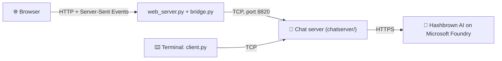

<p align="center">
  
</p>

<h1 align="center">🥔 Hashbrown Chat</h1>

<p align="center">
  A multiplayer chat with games, a token economy and an AI member called Hashbrown. Built as a school networking project.
</p>

<p align="center">
  
  
</p>

<p align="center">
  
</p>

---

## ✨ Features

- 💬 **Chat**: a lobby, group rooms, private messages (`/send`, with ✓ delivered and ✓✓ seen on the website), `/me` actions, nicknames, Hebrew (right-to-left) text, reactions, "is typing…", `/poll`, `@` autocomplete, a pinned room topic (`/pin`), `/search` in your rooms' history and private reminders (`/remind 10m text`).
- 👥 **Groups**: public groups, or 🔒 private groups where an admin approves you. Admins can kick, ban, mute, promote and demote.
- 💬 **Chat switcher** (website): 🌍 the Lobby and all your groups in one list, each its own conversation with its own messages, unread count and last message, like a messaging app.
- 🏦 **Group bank**: every group earns its own tokens and spends them on upgrades; ⚔️ group wars for the bank.
- 👥 **Groups screen** (website): every group by clicking. Join or ask to join, open a chat, and see each group's members (who's online), bank (history, top donors, a chart, donate) and every upgrade (owned, can buy, or how much is missing). A group's admins also get its join requests and buttons to kick, mute, ban, promote, set the topic, emoji and persona, or disband. Every button sends the normal command, so the server's rules still decide.
- 🪙 **Tokens**: earn them by being online, with a `/daily` streak, three daily `/quests`, winning games and achievements. Spend them in the badge shop or the casino (fake tokens only). `/give` has limits against farming with extra accounts (not in an account's first 24 hours, at most 500 a day).
- 🎮 **Games**: Tic-Tac-Toe, Damka (checkers), Math Duel, Connect 4, Battleship and solo Wordle; ELO ratings and `/leaderboard`, `/watch` someone's game. Challenge a friend, with an optional token bet; `/rematch`, and `/claim` if they stop moving.
- 🥔 **Hashbrown**: an AI member. Type `@hashbrown` in chat, or `/ask` for a private answer; it also comments on your games, judges arguments (`/judge`), translates (`/tr`), gives Wordle hints and asks a question of the day (answer it with `/answer`: the answer with the most reactions wins 50 🪙). Each question costs tokens; you can tip Hashbrown with `/give hashbrown 10`. Without an API key, Hashbrown is simply off.
- 🔁 **Reconnect and catch up**: if the Wi-Fi drops (or the website restarts), the website and `client.py` log back in by themselves and get exactly the messages they missed, once.
- 👤 **Profiles**: click a name for a profile card (avatar, status, bio, favourite game, record). Edit yours: avatar, display name, bio, status, name colour, theme (the same on every device), privacy (hide "last seen", who can message you) and your password. Terminal: `/profile`, `/setprofile`, `/password`.
- 🎨 **Drawing game**: `/draw` gives you a secret word to draw on the website's canvas; the others guess in the chat. Every brush stroke is one small packet (watch them in Packet X-ray).
- 🌐 **Website**: chat from any phone or laptop on the same Wi-Fi. Light and dark mode, clickable game boards, file sharing.
- ⌨️ **Terminal client**: `client.py` works in Terminal, Windows CMD and PyCharm.
- 📁 **Files**: send a file of up to 15 MB (in 1 MB chunks with a progress bar on the website). The receiver is asked first (📎 Accept / Decline, or `/accept file`), and an offer expires after 2 minutes.
- 🔬 **For the networking class**: a Packet X-ray window on the website (every packet, and the raw TCP chunks `recv()` got), `client.py --packets`, UDP auto-discovery, `/ping`, `/netstats`, a live 🗺️ network map (every player around the server, packets flying, each one's ping), and a network lab (the host types `lag 300` or `loss 10` in the server window to make the network worse on purpose; the website shows everyone a 🧪 banner while it's on).

## 🚀 Quick start

Python 3.8 or newer. **Nothing to install** for the chat itself: it uses only the standard library (only Hashbrown, the AI, needs one package, see [below](#-waking-up-hashbrown-optional)). Everyone must be on the **same Wi-Fi** (or LAN).

**1. Get the code**

```bash
git clone https://github.com/yanivsp2909/hashbrown-chat.git
cd hashbrown-chat
```

**2. Start the server** (the host runs this)

```bash
python server.py
```

It also starts the website on port 8080 (set `START_WEBSITE = False` in `chatserver/config.py` to run `python web/web_server.py` yourself).

**3. Join**

- 🌐 **Website**: open the link that `web_server.py` prints, for example `http://192.168.1.20:8080`.
- ⌨️ **Terminal**: run `python client.py` (it finds the server on the Wi-Fi by itself, or asks for the IP) or `python client.py <host IP>`. Press Enter to play in the terminal (or **2** to open the website; `--web` skips the question), then choose **2** to create an account or **1** to log in.

Type `/help` once you're in to see every command. The full list is in the [user guide](docs/GUIDE.md).

## 🥔 Waking up Hashbrown (optional)

Hashbrown needs the `openai` package and an API key for an AI endpoint on Microsoft Foundry. Install the package once (nothing else in the project needs it):

```bash
pip install -r requirements.txt
```

Without the package the server still starts; it just prints `Hashbrown needs the openai package` and Hashbrown stays off. Answers appear word by word in the website (the terminal client shows the full answer at the end).

Pick one of these ways to give it the key:

**Option A: an environment variable** (wins over the file)

macOS / Linux:
```bash
export HASHBROWN_API_KEY="your-key-here"
```

Windows PowerShell:
```powershell
$env:HASHBROWN_API_KEY="your-key-here"
```

**Option B: the config file**

The server creates `hashbrown_config.json` next to `server.py` on the first run. Fill in your endpoint, deployment and key:

```json
{
  "endpoint": "https://YOUR-RESOURCE.services.ai.azure.com/openai/v1",
  "deployment": "YOUR-DEPLOYMENT-NAME",
  "api_key": "PASTE-YOUR-KEY-HERE"
}
```

**Option C: macOS Keychain**

Store the key once (you type it yourself, and the terminal asks for it):

```bash
security add-generic-password -a "$USER" -s hashbrown-foundry -w
```

Then start the server with the helper script:

```bash
./start.sh
```

When Hashbrown is awake, the server log says `🥔 Awake!`.

> **No key?** Everything else still works. Hashbrown is just off.

## 🔐 Admin

Type `/admin <password>` in chat to get admin powers (for example `/admintokens`, `/hbstats`, or `/pin` in the lobby). The password is **never in the code** (this repo is public). It comes from the `HASHBROWN_ADMIN_PASSWORD` environment variable. On a Mac, save it in the Keychain as an item called `hashbrown-admin` and `start.sh` loads it:

```bash
security add-generic-password -a "$USER" -s hashbrown-admin -w
```

(It asks for the password, so it never shows up in your shell history.) A password shorter than 8 characters works, but the server prints one warning line. With no password, `/admin` is off.

## 🧠 How it works



### The protocol

Every packet is **one JSON object on one line**, ending with `\n`. That's called newline-delimited JSON.

| Direction | Type | Fields |
|---|---|---|
| client → server | `auth` | `action` (`login` or `register`), `username`, `password`, optional `features` (e.g. `["stream", "rooms"]`) |
| server → client | `rooms` | `current`, `rooms` (`key`, `name`, `title`): only for clients with the `rooms` feature |
| client → server | `line` | `text` (a chat message or a `/command`) |
| client → server | `file` | `to`, `filename`, `data` (base64) |
| server → client | `auth_result` | `ok`, `text` |
| server → client | `msg` | `kind`, `text` (board messages also have a `state` object; a file offer has `offer`: `id`, `from`, `filename`, `size`, only for clients with the `offers` feature) |
| server → client | `chat` | `time`, `name`, `badge`, `text`, `action`, `id`, and `room` (its key) for clients with the `rooms` feature |
| server → client | `stream` | `stream_id`, `append` (a piece of Hashbrown's answer, only for clients with the `stream` feature) |
| client → server | `ping` | `t` (any number; it comes straight back) |
| client → server | `typing` / `typing_stop` | (none): passed on with `name` to clients with the `typing` feature (start at once, a refresh every 2 s, stop on send) |
| client → server | `seen` | `id` (a private message's `pm_id`): its sender gets `receipt` |
| server → client | `receipt` | `id`, `status` (`delivered` or `seen`); the sender's copy of a `/send` has `pm` (`id`, `status`), the receiver's has `pm_id` |
| server → client | `topic` | `room`, `text` (the pinned topic; empty = none), on every room switch and when it changes |
| client → server | `get_groups` / `get_group` / `groups_closed` | (none) / `group` (its key) / (none): the website's Groups screen opens, looks at one group, closes |
| server → client | `groups` / `group_info` | `groups` (one card per group) / `group` (one group's details): sent when asked and once a second while the screen is open and something changed. A private group you're not in shows only its name, emoji and size; `bank_details` only goes to members, `admin` (requests, muted, banned) only to that group's admins |
| both ways | `auth` with `"action": "resume"` | `username`, `token`, `seq`: back after a drop. Every kept packet has an optional `seq`; `auth_result` has `resume_token` (and `resumed`); kick notices have `kicked` |
| client → server | `get_profile` / `change_password` | `name` / `old`, `new`: the server answers `profile` (`profile`, `mine`); your own comes at login with the `profiles` feature |
| both ways | `stroke` | `points` (0-1000), `color`, `size`, or `clear`: the drawer's brush, passed to the room's `draw` clients; `draw_round` says when a round starts and ends |
| client → server | `get_netmap` / `netmap_closed` | the network map opens/closes: the server sends `netmap` (`players`: room, ping, packets per type) once a second |
| both ways | `probe` / `probe_back` | `id`: the server's ping probe, only to clients with the `probe` feature |
| server → client | `lab` | `lag_ms`, `loss_percent` (the network lab changed; 0 and 0 = off) |
| client → server | `react` | `id` (a chat message), `emoji`: the room gets `reactions` with `id` and `counts` |
| client → server | `edit` / `delete` | `id` (your own message, for 10 min), `text`: the room gets `edited` / `deleted` |
| both ways | `file_start`, `file_chunk`, `file_ack`, `file_end`, `file_cancel` | big files in 1 MB chunks; the next chunk only after its `file_ack` (flow control) |
| server → client | `pong` | `t` (the same number: now minus `t` is the round trip) |
| UDP, client → everyone | `discover` | (none) — broadcast to port 8821 |
| UDP, server → client | `server` | `name`, `port`, `web_port` — the client uses the IP the answer came from |
| server → client | `history` | `room` (its title), `key` (which room), `messages` |
| server → client | `file` | `from`, `filename`, `data` |

The `kind` of a `msg` is one of `system`, `error`, `event`, `money`, `game`, `private`, `help` or `board`. New things are only ever *added* (new optional fields or packet types), so an old `client.py` keeps working: it ignores what it doesn't know. Here's what a chat line looks like on the wire:

```json
{"type": "line", "text": "hi everyone"}
```

**Why `\n`?** TCP sends a stream of bytes, not messages. One `recv()` might give you half a message, or three messages at once. So each side keeps collecting bytes until it sees a newline, and that's where the message ends. JSON never contains a raw newline inside a string (it's written as `\n`), so a newline is a safe separator.

## 📁 Project structure

```
hashbrown-chat/
├── server.py           starts the chat server
├── chatserver/         the server code, one topic per file
│   ├── config.py       every setting: ports, prices, limits (never the passwords)
│   ├── connections.py  accepts connections, one thread per person
│   ├── history.py      chat history in history.db (SQLite), every message has an id
│   ├── chat.py         what happens with each line someone types
│   ├── cmd_*.py        the /commands, grouped like /help
│   └── hashbrown_ai.py talks to the AI
├── games.py            Tic-Tac-Toe, Damka, Math Duel, Wordle (no networking)
├── client.py           the terminal client
├── web/                the website: web_server.py, bridge.py, static/
├── tests/              server tests (pytest)
└── docs/               the full user guide and images
```

## 🧪 Tests

Server tests (needs pytest, `pip install pytest`):

```bash
python -m pytest -q
```

Website tests (no install):

```bash
python -m unittest discover -s web/tests -v
```

The tests never call the real AI. They use a fake Hashbrown server on your own computer.

## 👥 Team

A school networking project by Yaniv, Daniel and Sagi.

## ⚠️ Security

> [!WARNING]
> **Messages are not encrypted, on purpose.** This is a networking school project, and the packets stay readable. You can watch them with Wireshark.
>
> - Anyone on the same network can read messages and passwords.
> - Run it only on a home or school network.
> - Never open it to the internet or set up port forwarding.
> - Don't reuse a real password here.

## 📜 License

[MIT](LICENSE)

---

📘 For every command, the full token economy and the server console, read the **[full user guide](docs/GUIDE.md)**.
