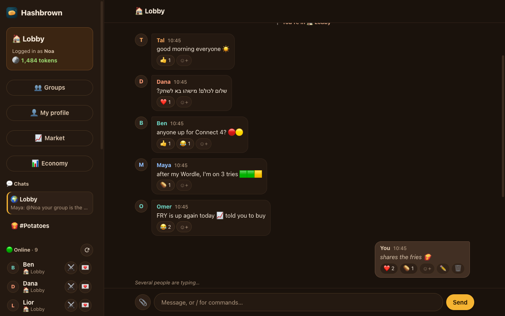
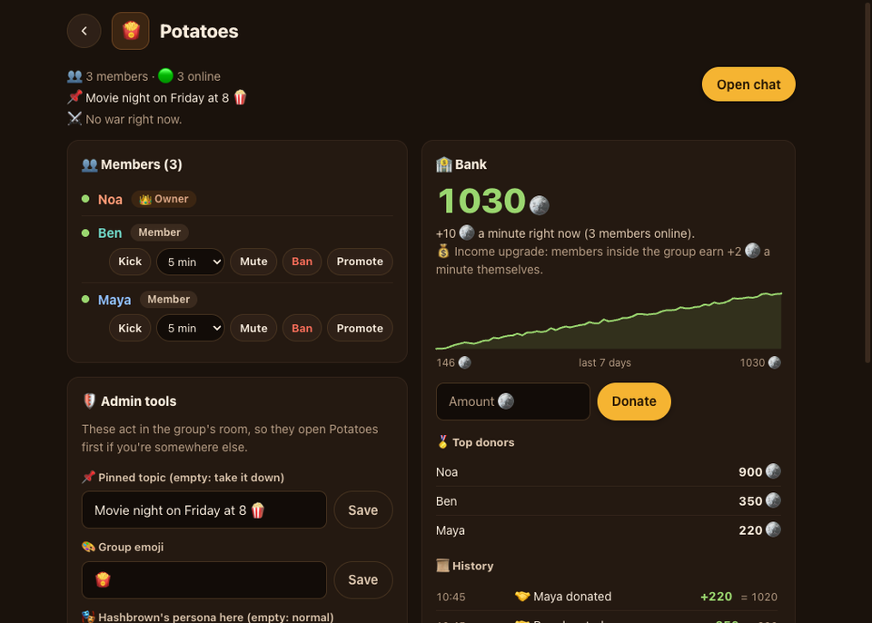
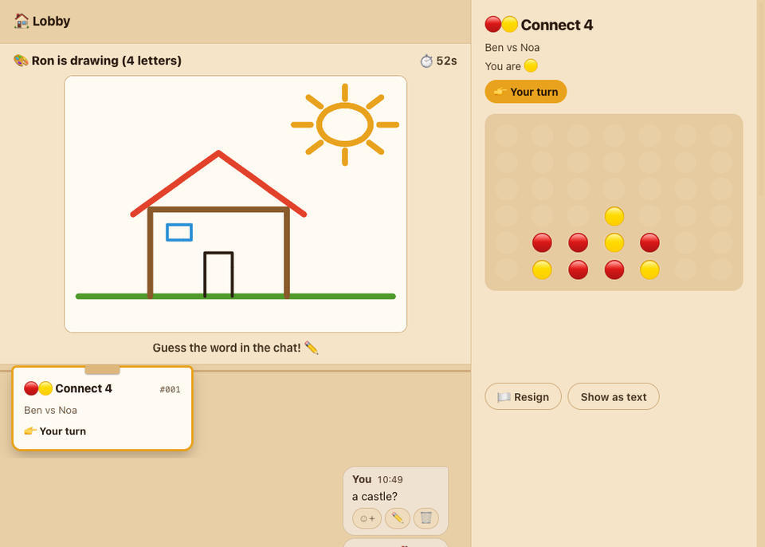
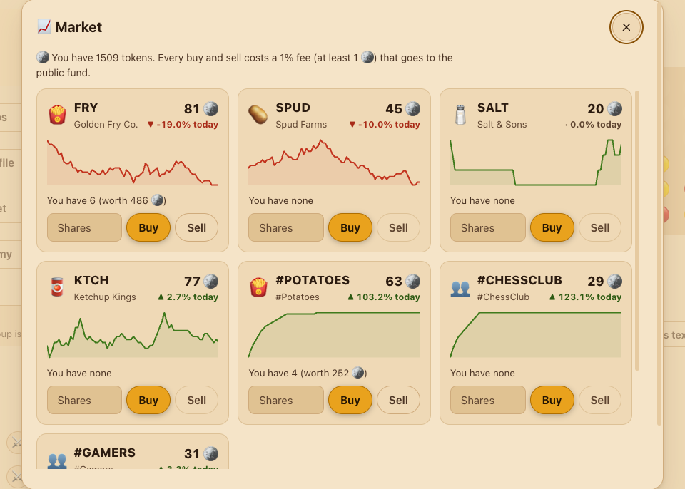
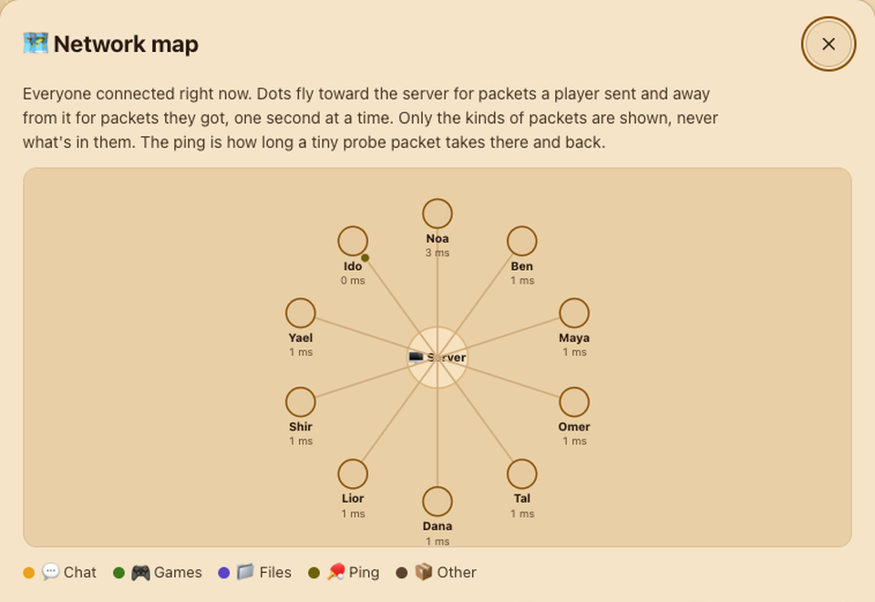
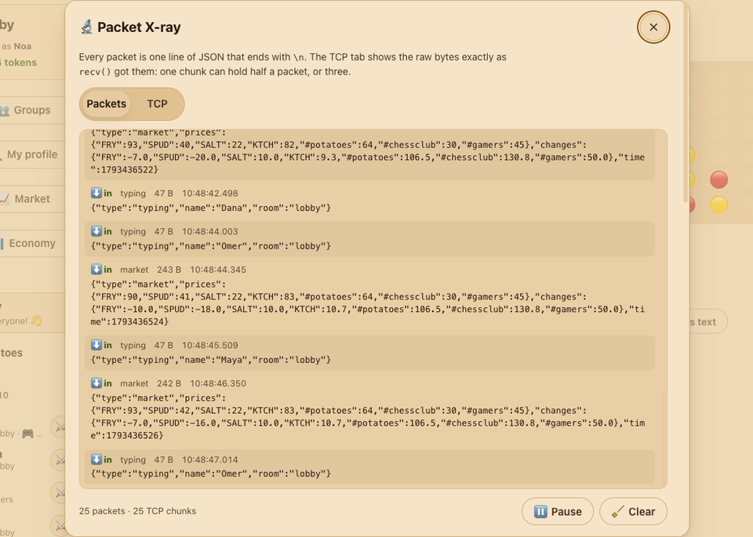
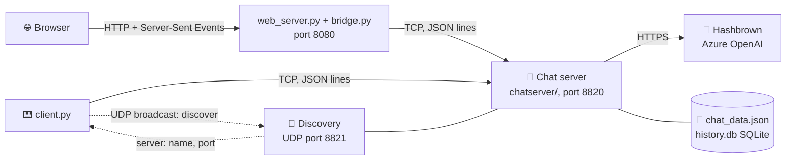

<p align="center">
  
</p>

<h1 align="center">🥔 Hashbrown Chat</h1>

<p align="center"><b>A LAN hangout for friends, built from raw Python sockets.</b></p>

<p align="center">
  
  <a href="LICENSE"></a>
  
  
</p>

<!-- 🎬 DEMO VIDEO: replace the next line with the link when the video is ready -->
<p align="center">🎬 <b>Demo video:</b> coming soon</p>

<p align="center">
  
</p>

## What is this

A school networking project by **Yaniv, Daniel Cohen Vitos and Sagi Shavit**. One computer runs the server; friends on the same Wi-Fi join from a browser or a terminal. Inside there's a chat with groups, seven games, a whole token economy with a stock market, and an AI member called Hashbrown. All of it travels over **our own protocol: one JSON object per line, on plain TCP sockets**. No frameworks, no web libraries; the client is a single standard-library file.

## ✨ Features

| | |
|---|---|
| 💬 **Chat** | A lobby and group rooms, private messages with ✓ delivered / ✓✓ seen, reactions, "is typing…", `@` mentions, polls, a pinned topic per room, `/search`, `/remind`, edit and delete, Hebrew right-to-left text. |
| 👥 **Groups** | Public or 🔒 private groups (an admin approves you), admins who kick, mute and ban, a group bank that earns tokens and buys upgrades, ⚔️ group wars, and a website screen with members, bank history and a chart. Group commands work inside the group's chat (and act on it); the Groups screen's buttons work from anywhere. Admins can 📨 invite people (private groups too) with an Accept / Decline card. |
| 🤝 **Friends** | `/friend add name` with an Accept / Decline card, a 👥 Friends list in the sidebar with who's online and what they're doing (in a game, in a group), quick buttons to message, challenge or invite them to your group, a notice when a friend comes online, and "friends only" for who can message you. |
| 🎮 **Games** | Tic-Tac-Toe, Damka (checkers), Math Duel, Connect 4, Battleship, solo Wordle and a 🎨 drawing game. Token bets, ELO ratings, `/watch` someone's match, daily quests. |
| 📈 **Economy** | Tokens for being online and winning, a `/daily` streak, a badge shop and a casino. A stock market (four companies plus every group), a public fund fed by taxes and fees, savings, loans, a player marketplace, auctions of rare badges and a live dashboard. |
| 🏢 **Hashbrown Ventures** | A startup game that lasts weeks, played by clicking: open 🏢 Ventures, start a company in one of five sectors (AI lab, cybersecurity, hardware, SaaS, game studio, each with its own tools), invite friends as co-founders with a role and equity, spend a few action points a day, and read the daily report at 21:00. Pitch an AI investor in your own words for a term sheet (accept, decline or counter), let friends invest their tokens as angels, ride the market events and the 📰 Ventures News. Run out of cash and the company dies (⚰️ the graveyard). Hashbrown writes the words; the server decides every number. Design: [docs/VENTURES.md](docs/VENTURES.md). |
| 🥔 **Hashbrown the AI** | Type `@hashbrown` in the chat or `/ask` privately. It sums up the chat, settles arguments, translates Hebrew ↔ English, comments on your games, asks a question of the day and writes market news. Answers stream in word by word. |
| 🔬 **Networking tools** | Packet X-ray, a raw TCP view, a live network map, a network lab that adds lag and loss, `/ping` and `/netstats`. See [Under the hood](#-under-the-hood). |
| 🌐 **Website and terminal** | The website works on any phone or laptop on the Wi-Fi (light and dark, clickable boards, files up to 15 MB). `client.py` runs in Terminal, CMD or PyCharm. Both reconnect by themselves and catch up on what they missed. |

<table>
  <tr>
    <td width="50%"><br><sub><b>👥 Groups + bank:</b> members, admin tools, the bank's chart and history</sub></td>
    <td width="50%"><br><sub><b>🎮 Games:</b> a drawing round in the chat and a Connect 4 match</sub></td>
  </tr>
  <tr>
    <td><br><sub><b>📈 Market:</b> company and group stocks with live charts</sub></td>
    <td><br><sub><b>🗺️ Network map:</b> every player, their ping and the packets flying</sub></td>
  </tr>
  <tr>
    <td><br><sub><b>🔬 Packet X-ray:</b> every JSON packet in and out</sub></td>
    <td><br><sub><b>💬 Group chat</b> in light mode, with its pinned topic</sub></td>
  </tr>
</table>

## 🚀 Quick start

You need **Python 3.8 or newer**. On Windows, type `python` where this says `python3`.

**1. Clone**

```bash
git clone https://github.com/yanivsp2909/hashbrown-chat.git
cd hashbrown-chat
```

**2. Install** (only for Hashbrown, the AI: everything else needs nothing)

```bash
pip install -r requirements.txt
```

**3. Start the server** (on the computer that hosts)

```bash
./start.sh          # macOS: takes the AI key and admin password from the Keychain
python3 server.py   # anywhere else
```

The server also starts the website and prints a link like `http://<your-ip>:8080`. Then friends on the same Wi-Fi:

- 🌐 open that link in a browser, or
- ⌨️ run `python3 client.py`: it finds the server on the Wi-Fi by itself (or asks for the IP).

Create an account, then type `/help` to see all 94 commands. The [user guide](docs/GUIDE.md) explains every one.

<details>
<summary>🔑 <b>The AI key and the admin password</b> (optional)</summary>

<br>

**Everything works without a key.** Hashbrown is simply off, and the server says so when it starts.

**The AI key** (Hashbrown runs on an Azure OpenAI deployment on Microsoft Foundry). Pick one:

- **An environment variable:** `export HASHBROWN_API_KEY="your-key"` (PowerShell: `$env:HASHBROWN_API_KEY="your-key"`), then `python3 server.py`.
- **The macOS Keychain:** save it once with `security add-generic-password -a "$USER" -s hashbrown-foundry -w` (it asks for the key, so it never lands in your shell history), then start with `./start.sh`.
- **A file:** the server creates `hashbrown_config.json` on its first run. Put your endpoint, deployment and key in it. It's in `.gitignore`: never commit it.

**The admin password** (for `/admin`, which unlocks `/admintokens`, `/hbstats`, `/auction` and pinning the lobby topic). It is never in the code, because this repo is public. Save it in the Keychain as `hashbrown-admin` and `start.sh` loads it:

```bash
security add-generic-password -a "$USER" -s hashbrown-admin -w
```

Or set the `HASHBROWN_ADMIN_PASSWORD` environment variable yourself. With no password, `/admin` is off.

</details>

## 🧠 How it works



**Why every packet ends with `\n`.** TCP is a stream of bytes, not of messages: one `recv()` can return half a packet, or three at once. So each side keeps collecting bytes until it sees a newline, and that's where a packet ends. JSON never has a raw newline inside a string (it's written as `\n`), so a newline is a safe separator. A chat line on the wire looks like this:

```json
{"type": "line", "text": "hi everyone"}
```

**The main packets** (the full list is in the [user guide](docs/GUIDE.md#-the-protocol)):

| Packet | Direction | What it does |
|---|---|---|
| `auth` / `auth_result` | client → server → client | Log in or register (or resume after a drop); the answer and a reconnect token |
| `line` | client → server | Everything you type: a chat message or a `/command` |
| `chat` | server → clients | A chat message with its id, time, name and room |
| `msg` | server → client | A notice: system, error, money, game, private, board… |
| `history` | server → client | The recent messages of the room you just entered |
| `ping` / `pong` | both ways | Measures the round trip |
| `file_start`, `file_chunk`, `file_ack`… | both ways | Big files in 1 MB pieces, each one acknowledged before the next (flow control) |
| `market` | server → everyone | The minute's stock prices, one packet for all |
| `discover` / `server` | UDP broadcast / reply | How `client.py` finds a server on the Wi-Fi |

**Threads and one lock.** The main thread only calls `accept()`; every connection gets its own thread. All shared data (who's online, accounts, groups) is guarded by a single `threading.RLock`. Each client also has an outbox queue and a writer thread, so one slow phone can't freeze everyone. Calls to the AI run in their own thread, outside the lock, so the chat keeps going while Hashbrown thinks.

**Reconnect with sequence numbers.** Every packet the server keeps for you gets a `seq` number, and the last 500 (up to 10 minutes) are remembered. When the Wi-Fi drops, the app logs back in with a one-use token and the last `seq` it saw, and the server sends exactly the packets in between, once.

**UDP vs TCP.** Finding the server uses **UDP**: one broadcast packet reaches every computer on the Wi-Fi without a connection, and if it's lost the client simply asks for the IP. The chat itself uses **TCP**: nothing may get lost or arrive out of order. The network lab shows the price of that: when a packet is "lost", TCP sends it again and everything behind it waits (head-of-line blocking).

## 🔬 Under the hood

Tools we built to *see* the networking, for learning:

- **Packet X-ray** (website, bottom of the sidebar): every JSON packet your tab sends ⬆ and gets ⬇, in a side panel (a drawer under the chat on a phone) that never blocks the chat, so you can chat and play while you watch. It records from the moment the page loads (the newest 500), with Pause, Clear and a filter by packet type. Passwords and reconnect tokens show as •••. In the terminal: `python3 client.py --packets`.
- **The TCP tab** (inside X-ray): the raw bytes of each `recv()` from the very first one, with newlines shown as ⏎, so you can see a chunk end in the middle of a packet.
- **The network lab** (typed in the server window): `lag 300` delays every packet by 300 ms, `loss 10` "loses" 10% of them, `lab off` stops it. Everyone on the website sees a 🧪 banner while it's on.
- **The live network map** (website): the server in the middle, every player around it, dots flying for packets sent and received, and each player's ping. Only packet types and counts, never what's inside.
- **`/ping` and `/netstats`**: the round-trip time of one packet, and how many packets and bytes went each way on your connection.

## 🧪 Quality

- **948 server tests** (pytest) start the real server on a free port and connect fake clients; **49 website tests** run the website against a server copy in a temporary folder (some run the website's JavaScript rules in Node).
- **The tests never call the real AI**: a fake Hashbrown server runs on your own computer.
- **The bug hunt:** every round ended with a code review and a security review. They closed farming tokens with new accounts, look-alike names, files arriving without being asked, short passwords, and three ways to print or move tokens unfairly in the economy. Two flaky tests were tracked down to timing races and fixed.
- **Old clients keep working:** the protocol only grows (new optional fields and new packet types), and every app ignores what it doesn't know.

Run them:

```bash
pip install pytest
python3 -m pytest -q                          # server tests (about a minute)
python3 -m unittest discover -s web/tests     # website tests (no install)
```

## 📁 Project structure

```
hashbrown-chat/
├── server.py        starts the chat server (and the website)
├── chatserver/      the server, one topic per file: connections, chat, games, economy, Hashbrown...
│   ├── config.py    every setting: ports, prices, limits (never a password or key)
│   └── cmd_*.py     the /commands, grouped like /help
├── games.py         the game rules (no networking)
├── client.py        the terminal client: one file, standard library only
├── web/             the website: web_server.py, bridge.py and static/ (HTML, CSS, JS modules)
├── tests/           server tests (pytest)
├── start.sh         macOS start script (reads the Keychain)
└── docs/            the user guide, build progress and images
```

## 👥 Team

**Yaniv, Daniel Cohen Vitos and Sagi Shavit**, as a school networking project.

## ⚠️ No encryption, on purpose

> [!WARNING]
> **Nothing is encrypted.** This is a networking project: the packets stay readable so you can study them (open Packet X-ray, or Wireshark). That also means anyone on the same network can read the messages, passwords included.
>
> - Run it only on a **home or school network**.
> - Never open it to the internet or set up port forwarding.
> - Don't reuse a real password here.

## 📜 License

[MIT](LICENSE)
