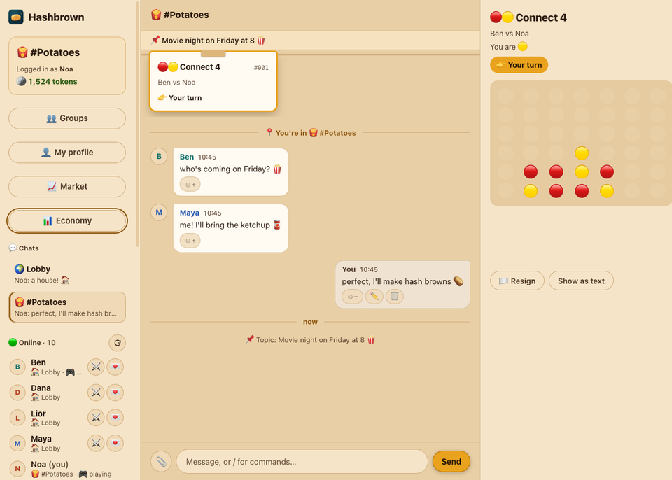
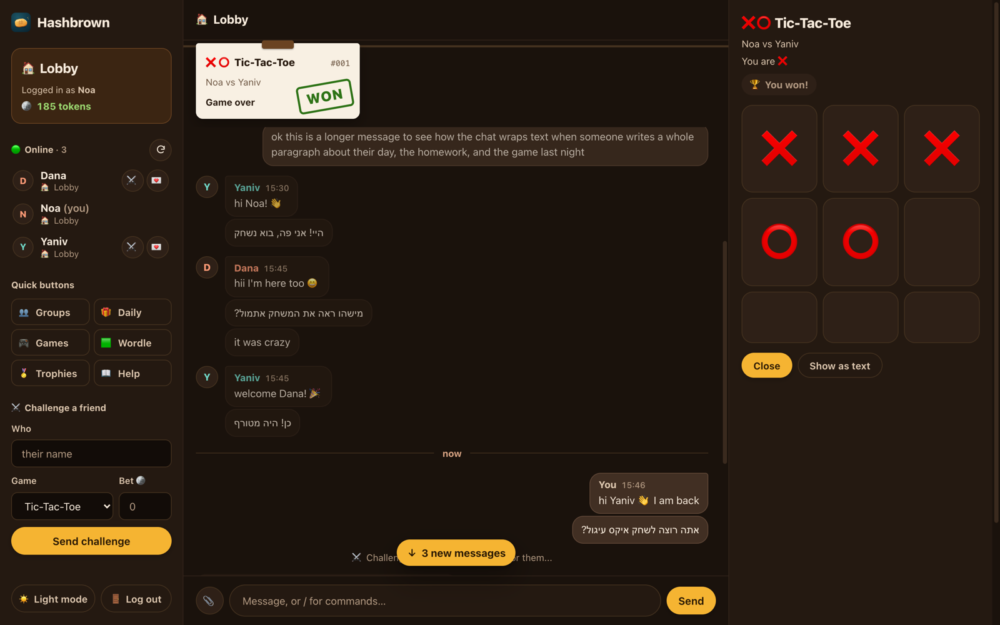
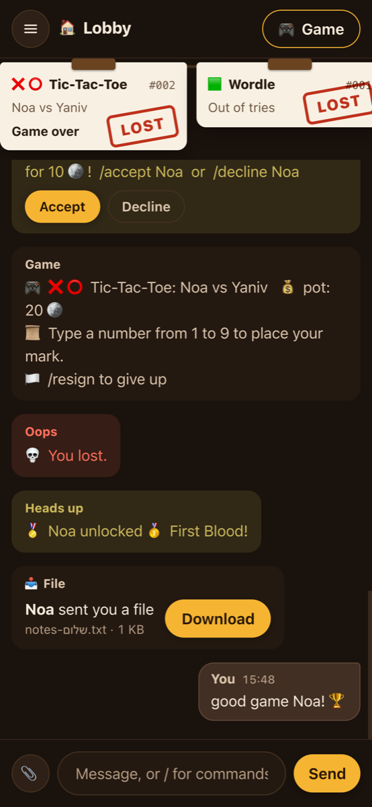
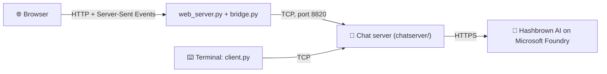

<p align="center">
  
</p>

<h1 align="center">🥔 Hashbrown Chat</h1>

<p align="center">
  A multiplayer chat with games, a token economy and an AI member called Hashbrown. Built as a school networking project.
</p>

<p align="center">
  
  
</p>

<p align="center">
  
</p>

---

## ✨ Features

- 💬 **Chat**: a lobby, group rooms, private messages (`/send`), `/me` actions, nicknames and Hebrew (right-to-left) text.
- 👥 **Groups**: public groups, or 🔒 private groups where an admin approves you. Admins can kick, ban, mute, promote and demote.
- 🏦 **Group bank**: every group earns its own tokens and spends them on upgrades.
- 🪙 **Tokens**: earn them by being online, with a `/daily` streak, winning games and achievements. Spend them in the badge shop or the casino (fake tokens only).
- 🎮 **Games**: Tic-Tac-Toe, Damka (checkers), Math Duel and solo Wordle. Challenge a friend, with an optional token bet.
- 🥔 **Hashbrown**: an AI member. Type `@hashbrown` in chat, or `/ask` for a private answer. Each question costs tokens. Without an API key, Hashbrown is simply off.
- 🌐 **Website**: chat from any phone or laptop on the same Wi-Fi. Light and dark mode, clickable game boards, file sharing.
- ⌨️ **Terminal client**: `client.py` works in Terminal, Windows CMD and PyCharm.
- 📁 **Files**: send a file of up to 2 MB.

## 🚀 Quick start

Python 3.8 or newer. **Nothing to install** for the chat itself: it uses only the standard library (only Hashbrown, the AI, needs one package, see [below](#-waking-up-hashbrown-optional)). Everyone must be on the **same Wi-Fi** (or LAN).

**1. Get the code**

```bash
git clone https://github.com/yanivsp2909/hashbrown-chat.git
cd hashbrown-chat
```

**2. Start the server** (the host runs this)

```bash
python server.py
```

It also starts the website on port 8080 (set `START_WEBSITE = False` in `chatserver/config.py` to run `python web/web_server.py` yourself).

**3. Join**

- 🌐 **Website**: open the link that `web_server.py` prints, for example `http://192.168.1.20:8080`.
- ⌨️ **Terminal**: run `python client.py <host IP>` with the host's IP address. Press Enter to play in the terminal (or **2** to open the website; `--web` skips the question), then choose **2** to create an account or **1** to log in.

Type `/help` once you're in to see every command. The full list is in the [user guide](docs/GUIDE.md).

## 🥔 Waking up Hashbrown (optional)

Hashbrown needs the `openai` package and an API key for an AI endpoint on Microsoft Foundry. Install the package once (nothing else in the project needs it):

```bash
pip install -r requirements.txt
```

Without the package the server still starts; it just prints `Hashbrown needs the openai package` and Hashbrown stays off. Answers appear word by word in the website (the terminal client shows the full answer at the end).

Pick one of these ways to give it the key:

**Option A: an environment variable** (wins over the file)

macOS / Linux:
```bash
export HASHBROWN_API_KEY="your-key-here"
```

Windows PowerShell:
```powershell
$env:HASHBROWN_API_KEY="your-key-here"
```

**Option B: the config file**

The server creates `hashbrown_config.json` next to `server.py` on the first run. Fill in your endpoint, deployment and key:

```json
{
  "endpoint": "https://YOUR-RESOURCE.services.ai.azure.com/openai/v1",
  "deployment": "YOUR-DEPLOYMENT-NAME",
  "api_key": "PASTE-YOUR-KEY-HERE"
}
```

**Option C: macOS Keychain**

Store the key once (you type it yourself, and the terminal asks for it):

```bash
security add-generic-password -a "$USER" -s hashbrown-foundry -w
```

Then start the server with the helper script:

```bash
./start.sh
```

When Hashbrown is awake, the server log says `🥔 Awake!`.

> **No key?** Everything else still works. Hashbrown is just off.

## 🔐 Admin

Type `/admin <password>` in chat to get admin powers (for example `/admintokens`). The password is `ADMIN_PASSWORD` in `chatserver/config.py`, which is set to `123` by default. **Change it before you share the server.** The `HASHBROWN_ADMIN_PASSWORD` environment variable overrides the file. An empty password turns `/admin` off.

## 🧠 How it works



### The protocol

Every packet is **one JSON object on one line**, ending with `\n`. That's called newline-delimited JSON.

| Direction | Type | Fields |
|---|---|---|
| client → server | `auth` | `action` (`login` or `register`), `username`, `password`, optional `features` (e.g. `["stream"]`) |
| client → server | `line` | `text` (a chat message or a `/command`) |
| client → server | `file` | `to`, `filename`, `data` (base64) |
| server → client | `auth_result` | `ok`, `text` |
| server → client | `msg` | `kind`, `text` (board messages also have a `state` object) |
| server → client | `chat` | `time`, `name`, `badge`, `text`, `action`, `id` |
| server → client | `stream` | `stream_id`, `append` (a piece of Hashbrown's answer, only for clients with the `stream` feature) |
| server → client | `history` | `room`, `messages` |
| server → client | `file` | `from`, `filename`, `data` |

The `kind` of a `msg` is one of `system`, `error`, `event`, `money`, `game`, `private`, `help` or `board`. New things are only ever *added* (new optional fields or packet types), so an old `client.py` keeps working: it ignores what it doesn't know. Here's what a chat line looks like on the wire:

```json
{"type": "line", "text": "hi everyone"}
```

**Why `\n`?** TCP sends a stream of bytes, not messages. One `recv()` might give you half a message, or three messages at once. So each side keeps collecting bytes until it sees a newline, and that's where the message ends. JSON never contains a raw newline inside a string (it's written as `\n`), so a newline is a safe separator.

## 📁 Project structure

```
hashbrown-chat/
├── server.py           starts the chat server
├── chatserver/         the server code, one topic per file
│   ├── config.py       every setting: ports, prices, ADMIN_PASSWORD
│   ├── connections.py  accepts connections, one thread per person
│   ├── history.py      chat history in history.db (SQLite), every message has an id
│   ├── chat.py         what happens with each line someone types
│   ├── cmd_*.py        the /commands, grouped like /help
│   └── hashbrown_ai.py talks to the AI
├── games.py            Tic-Tac-Toe, Damka, Math Duel, Wordle (no networking)
├── client.py           the terminal client
├── web/                the website: web_server.py, bridge.py, static/
├── tests/              server tests (pytest)
└── docs/               the full user guide and images
```

## 🧪 Tests

Server tests (needs pytest, `pip install pytest`):

```bash
python -m pytest -q
```

Website tests (no install):

```bash
python -m unittest discover -s web/tests -v
```

The tests never call the real AI. They use a fake Hashbrown server on your own computer.

## 👥 Team

A school networking project by Yaniv, Daniel and Sagi.

## ⚠️ Security

> [!WARNING]
> **Messages are not encrypted, on purpose.** This is a networking school project, and the packets stay readable. You can watch them with Wireshark.
>
> - Anyone on the same network can read messages and passwords.
> - Run it only on a home or school network.
> - Never open it to the internet or set up port forwarding.
> - Don't reuse a real password here.

## 📜 License

[MIT](LICENSE)

---

📘 For every command, the full token economy and the server console, read the **[full user guide](docs/GUIDE.md)**.
